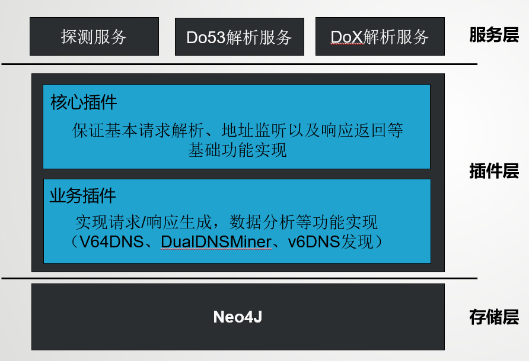
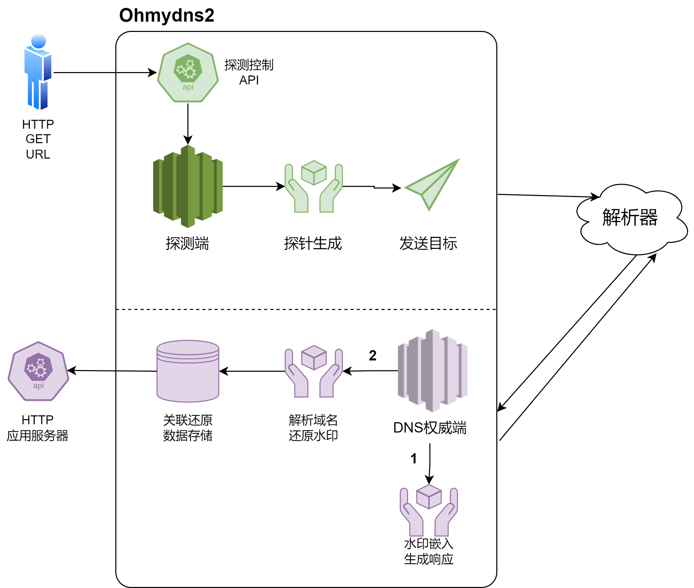

# Ohmydns2
## 功能
基于coredns改进而来的DNS服务组件，主要用于DNS解析器的测量，可同时作为探测器和自建权威服务。

- IPv6 解析器发现
- 解析器属性挖掘（IP属性，部署方式）
## 项目架构

### 使用

### 核心插件
存放在/plugin/pkg中，负责所有底层DNS请求、响应的实现（类似于sapp解析层插件）

### 业务插件
存放在plugin，负责各种业务层处理实现（类似于sapp业务层插件）
## 部署方式
项目打包为Docker镜像进行容器化部署
## 配置项
### Ohmyfile
参照coredns的corefile
#### v64DNS
```
 v64dns zone {
        ...
    }
```
`zone`代表权威负责解析子域的上一级父域，例如假设自建权威负责`v4.n64.top`域的解析，则`zone`为`n64.top`

| 配置项        | 语法格式                               | 说明                                     | 示例               |
|------------|------------------------------------|----------------------------------------|------------------|
| v4ns       | v4ns <域名> <IP地址>                   | 负责v4子域的NS信息，需要与域名注册商的信息保持一致            | v4ns ns4 1.1.1.1 |
| v6ns       | v6ns <域名> <IP地址>                   | 负责v6子域的NS信息，需要与域名注册商的信息保持一致            | v6ns ns6 2001::1 |
| chain      | chain <v4域名> <v6域名>                | 是否进行v4/v6-only子域名切换，以及对应的v4/v6-only子域名 |                  |
| ip-embed   | ip-embed                           | 布尔型配置项，控制是否进行ip嵌入                      |                  |
| chain-mlen | chain-mlen <整数>                    | 最大CNAME解析链长度                           |                  |
| analyze    | analyze <数据库类型> <数据库地址> <用户名> <密码> | 分析结果的存储位置，目前仅支持neo4j图数据库               |                  |


## API设计
### 探测控制
通过HTTP访问的方式控制探测部分，默认开放端口2115，访问路径`/prober`
#### 参数

| 参数名    | 说明                               | 示例         |
|--------|----------------------------------|------------|
| /      | 无参数时，默认展示所有的探测任务状态               | /          |
| act    | 新建一个或停止指定（全部）任务（停止指定任务需要配合pid参数） | new/stop   |
| pid    | 探测任务id                           | 1542772752 |
| prange | 探测范围，默认为全球，可指定为一个IP              | 8.8.8.8    |
| ptype  | 探测任务类型，默认为v64                    | v64        |
| loop   | 是否不间断重复探测任务,默认为false             | false      |

#### 探测任务


## 库表设计
### MySQL数据库
待定
### 图数据库--Neo4J
#### 节点——ResolverFromDo53
节点ID由Neo4J自动分配管理

| 属性名      | 说明                                | 示例                |
|----------|-----------------------------------|:------------------|
| AS       | 自治域号                              | AS15169           |
| COU      | 国家                                | China             |
| CODE     | 国家代码                              | CN                |
| LAT      | 纬度                                | 39.916527         |
| LNG      | 经度                                | 116.397128        |
| ISP      | 服务商                               | Google Inc.       |
| IPtype   | IP类型(v4/v6)                       | v6                |
| PROVINCE | 省份                                | Beijing           |
| TIME     | 首次发现时间                            | 1234892919.655932 |
| LTIME    | 最近一次发现时间                          | 1234892919.655932 |
| IP       | IP地址                              | 2001::1           |
| W        | 权重，实际等于总共被发现的次数，用以表现在实际解析中节点的关键程度 | 1                 |

#### 边（关联）
neo4j通过分别匹配相同的源节点和目的节点来找到对应的边

| 属性名 | 说明                                  | 示例 |
|-----|-------------------------------------|----|
| W   | 权重，实际等于总共被发现的次数，用以表现实际解析中该解析路径的关键程度 | 1  |


