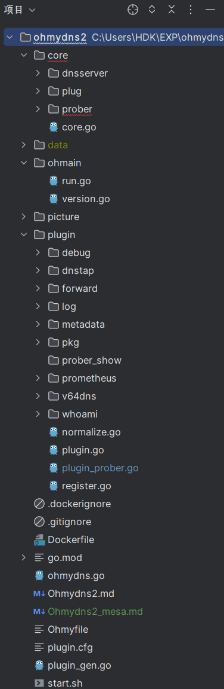
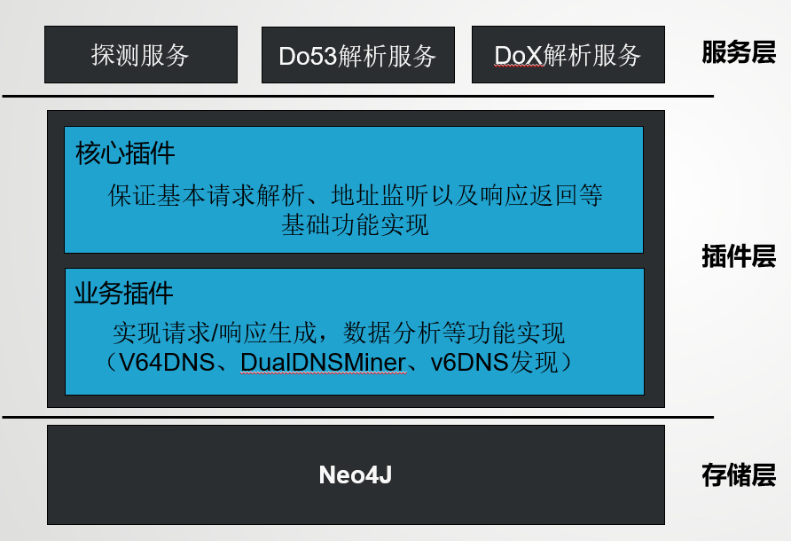
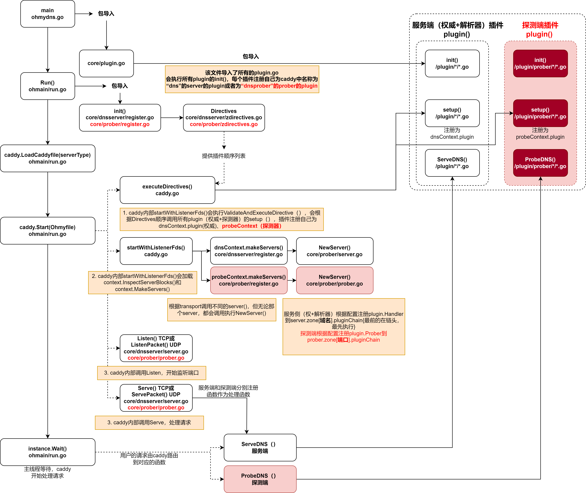
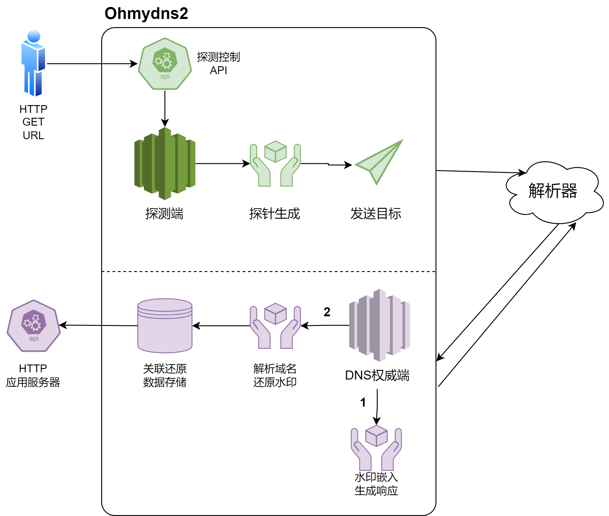
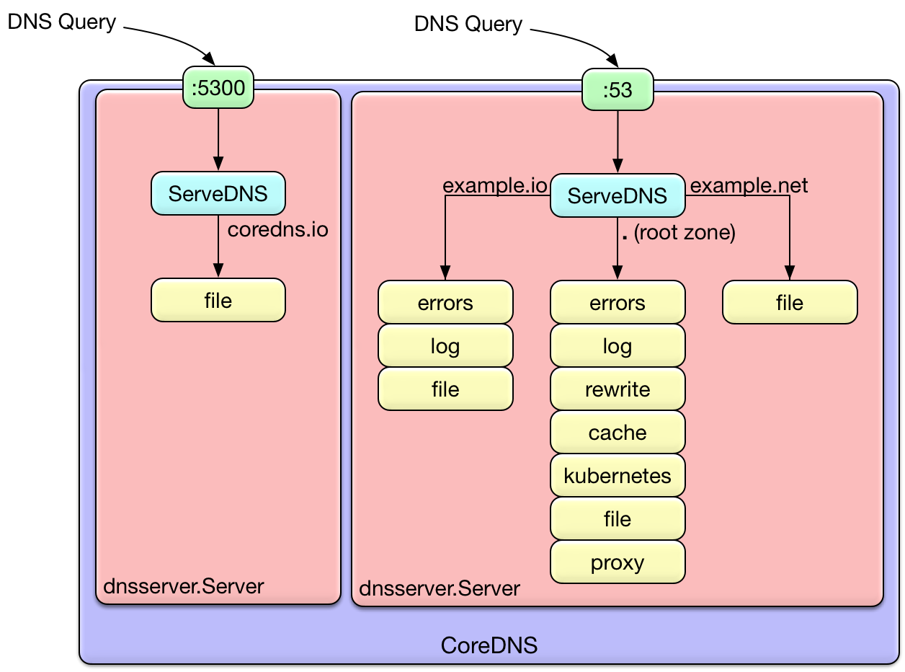

# IPv6 DNS服务测绘工具——Ohmydns2
## 功能需求
基于coredns改进而来的DNS服务组件，以caddy作为底层调度实现。主要用于DNS解析器的测量，通过多种插件，可同时作为探测器、解析器以及自建权威服务。
借助CNAME重定向的原理，可以通过IPv4 DNS入口发现IPv6递归解析器以及两者之间的关联关系。


## 部署环境
**系统** 

Linux/Mac

**网络环境** 

IPv4/IPv6双栈

**其他环境** 

Docker、 Neo4J
## 项目目录结构


### 目录以及关键文件解释
`/core`是探测端和DNS服务端核心基础代码的实现

`/core/prober`主要包括探测端在caddy中的注册、启动，以及核心处理逻辑代码，提供了探测端的HTTP API接口

`/core/dnsserver`主要包括服务端在caddy中的注册、启动，以及核心处理逻辑代码。目前支持DoH/Do53/DoT的解析服务

`/ohmain`是项目的启动入口，主要通过调用caddy的一系列接口完成服务注册、端口监听和请求处理工作

`/plugin`是业务插件的集合，其中探测端的插件存储在`/plugin/prober`中。为规范代码风格，所有业务插件包需要包含两部分：`setup.go`和`XXX.go`,
其中`setup.go`用于将业务插件注册到插件链中，详情可参考`whoami`插件的实现(`/plugin/whoami`)

`/plugin/pkg`是核心功能插件集合,这些插件无需注册，可视为项目功能的工具集合

## 项目架构


### 主要运行机理


注：红色部分为基于coredns架构的自主实现
### 使用
以v64DNS插件的使用为例


说明：
1. OhmyDNS2的探测器侧将会接收来自于HTTP API请求中的参数来创建不同的探测任务，并且利用配置文件Ohmyfile中的；

2. 解析服务部分将根据配置文件中不同域名服务块内定义的插件链依次调用插件，各插件处理完成之后返回结果

### 核心插件
存放在/plugin/pkg中，负责所有底层DNS请求、响应的实现（类似于sapp解析层插件）

### 业务插件
存放在plugin，负责各种业务层处理实现（类似于sapp业务层插件）
### 插件注册方式
所有插件均需要实现`init()`函数以在插件链中注册,例如
```go
func init() { plugin.Register("插件名", setup) }
```
`setup`是一个函数，这个函数一般用于解析配置文件中的参数，并返回一个可调用对象给caddy
该对象可在另一个`**.go`中进行定义，并且需要实现**ServeDNS()**（用于服务端）或者**ProbeDNS()** （用于探测端）方法
## 部署方式
项目打包为Docker镜像进行容器化部署，
## 配置项
### Ohmyfile
参照coredns的corefile
#### v64DNS
```
 v64dns zone {
        ...
    }
```
`zone`代表权威负责解析子域的上一级父域，例如假设自建权威负责`v4.n64.top`域的解析，则`zone`为`n64.top`

| 配置项        | 语法格式                               | 说明                                     | 示例               |
|------------|------------------------------------|----------------------------------------|------------------|
| v4ns       | v4ns <域名> <IP地址>                   | 负责v4子域的NS信息，需要与域名注册商的信息保持一致            | v4ns ns4 1.1.1.1 |
| v6ns       | v6ns <域名> <IP地址>                   | 负责v6子域的NS信息，需要与域名注册商的信息保持一致            | v6ns ns6 2001::1 |
| chain      | chain <v4域名> <v6域名>                | 是否进行v4/v6-only子域名切换，以及对应的v4/v6-only子域名 |                  |
| ip-embed   | ip-embed                           | 布尔型配置项，控制是否进行ip嵌入                      |                  |
| chain-mlen | chain-mlen <整数>                    | 最大CNAME解析链长度                           |                  |
| analyze    | analyze <数据库类型> <数据库地址> <用户名> <密码> | 分析结果的存储位置，目前仅支持neo4j图数据库               |                  |


## API设计
### 探测控制
通过HTTP访问的方式控制探测部分，默认开放端口2115，访问路径`/prober`
#### 参数
探测端插件可通过上下文方式接受自定义参数，但需要避免和以下参数冲突

| 参数名    | 说明                               | 示例         |
|--------|----------------------------------|------------|
| /      | 无参数时，默认展示所有的探测任务状态               | /          |
| act    | 新建一个或停止指定（全部）任务（停止指定任务需要配合pid参数） | new/stop   |
| pid    | 探测任务id                           | 1542772752 |
| prange | 探测范围，默认为全球，可指定为一个IP              | 8.8.8.8    |
| ptype  | 探测任务类型，默认为v64                    | v64        |
| loop   | 是否不间断重复探测任务,默认为false             | false      |

## 库表设计——V64DNS
### MySQL数据库
本项目暂未使用Mysql存储，因而待定
### 图数据库--Neo4J
#### 节点——ResolverFromDo53
节点ID由Neo4J自动分配管理

| 属性名      | 说明                                | 示例                |
|----------|-----------------------------------|:------------------|
| AS       | 自治域号                              | AS15169           |
| COU      | 国家                                | China             |
| CODE     | 国家代码                              | CN                |
| LAT      | 纬度                                | 39.916527         |
| LNG      | 经度                                | 116.397128        |
| ISP      | 服务商                               | Google Inc.       |
| IPtype   | IP类型(v4/v6)                       | v6                |
| PROVINCE | 省份                                | Beijing           |
| TIME     | 首次发现时间                            | 1234892919.655932 |
| LTIME    | 最近一次发现时间                          | 1234892919.655932 |
| IP       | IP地址                              | 2001::1           |
| W        | 权重，实际等于总共被发现的次数，用以表现在实际解析中节点的关键程度 | 1                 |

#### 边（关联）
neo4j通过分别匹配相同的源节点和目的节点来找到对应的边

| 属性名 | 说明                                  | 示例 |
|-----|-------------------------------------|----|
| W   | 权重，实际等于总共被发现的次数，用以表现实际解析中该解析路径的关键程度 | 1  |


## 与CoreDNS主要不同
1. CoreDNS纯粹设计作为解析器或者权威服务器（dnsserver）工作，Ohmydns在此基础上增加了Prober的功能
2. OhmyDNS充分吸收了CoreDNS**插件处理**的思想，不仅完全兼容CoreDNS的dnsserver插件，OhmyDNS还增加了针对探测器（prober）的插件接口


